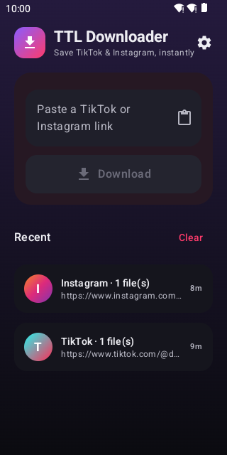
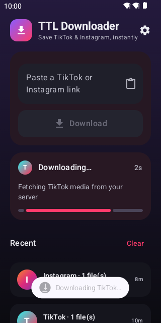
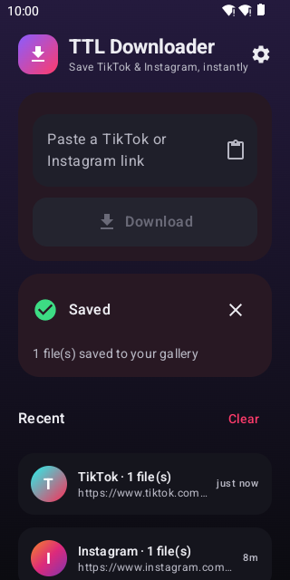
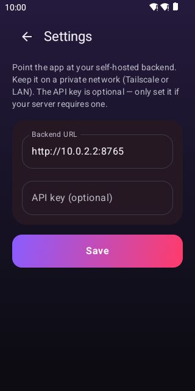
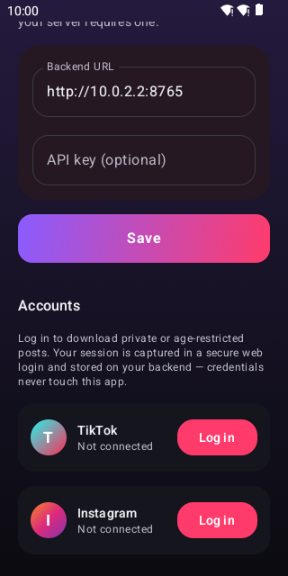
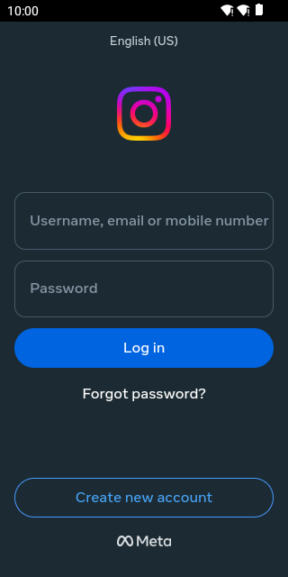

# Still Here — Android

A small, native Android client for the self-hosted [`ttl-downloader`](../ttl-downloader) backend. It
sends TikTok and Instagram links to your own server (which runs `yt-dlp` / `gallery-dl`) and saves the
returned media straight into your phone's gallery.

Still Here is a **thin client** to your backend — it does no extraction itself. It hands the backend a
URL and streams the result to the gallery. Still Here Local is the other flavor: no backend at all, it
does the extraction on the phone itself, with a bundled yt-dlp. Both are built for **personal / sideload**
use (no Play Store), Android only.

## Two apps, one codebase

| | **Still Here** (`server`) | **Still Here Local** (`local`) |
|---|---|---|
| Does the work | your `ttl-downloader` backend | this phone, with a bundled yt-dlp |
| Save posts (TikTok, Instagram, YouTube) | yes | yes |
| Record a live | yes | not yet |
| Auto-record, shared register | yes | no |
| Sessions stored | on the backend | on the phone only |
| Setup | a backend URL | none |

Both install side by side (`com.stillhere.app` and `com.stillhere.app.local`).
Local reads TikTok itself (yt-dlp can't on Android), falls back to tikwm.com only
when that fails, and uses Instagram's media API for photo posts. The media API
needs an Instagram sign-in.

## Screenshots

| Home | Downloading | Saved |
| :---: | :---: | :---: |
|  |  |  |

| Settings | Accounts | Web login |
| :---: | :---: | :---: |
|  |  |  |

> **These screenshots are of the previous dark-themed app and are out of date.**
> 1.0 is *the Ledger*: cream paper on a ruled board, an oxblood margin rule,
> rubber-stamp statuses and square corners throughout — the same design language
> as the web app. Replace them after the next device run.

## Features

- **Share-sheet import** — in TikTok or Instagram, tap **Share → Still Here** and the download starts
  automatically. No copy-paste.
- **Save to gallery** — videos land in `Movies/StillHere`, images in `Pictures/StillHere`, and
  show up in your gallery app. No storage permission needed (scoped storage / MediaStore).
- **Clipboard auto-detect** — copy a TikTok/Instagram link, open the app, and a one-tap banner offers to
  download it.
- **Foreground service** — downloads keep running (with a progress notification) even if you leave the app,
  which matters because server-side downloads can take 30–120s.
- **Auto-record** — place a standing order for a creator who is not live yet; the server watches and
  starts recording the moment they go live.
- **Account login for private media** — sign in to TikTok/Instagram in a secure in-app web login. The app
  captures only the resulting `sessionid` cookie and stores it on *your* backend, which then uses it to
  download private or age-restricted posts. Your username/password never touch the app.

## How it talks to the backend

| Action | Request |
| --- | --- |
| Start a TikTok download | `POST {baseUrl}/downloads` with `{ "url": "..." }` |
| Start an Instagram download | `POST {baseUrl}/instagram/downloads` with `{ "url": "..." }` |
| Fetch a resulting file | `GET {baseUrl}{file_url}` (paths come back in `file_urls`) |
| TikTok login status / save / clear | `GET /auth/status` · `POST /auth/tiktok-cookies {session_ss}` · `DELETE /auth/tiktok-cookies` |
| Instagram login status / save / clear | `GET /instagram/auth/status` · `POST /instagram/auth/cookies {sessionid}` · `DELETE /instagram/auth/cookies` |

Platform is chosen automatically from the link's hostname. Each file is fetched exactly once — the
Instagram endpoint deletes its server-side copy after serving. An optional `X-API-Key` header is sent when
an API key is configured in Settings. For login, the app reads the `sessionid` cookie from the web-login
WebView and posts it to the backend. Note the field name is historical: TikTok has no `session_ss`
cookie, it authenticates on `sessionid`, and the backend stores whatever value it is given under every
session cookie name the recorder might look for. Sending only `sessionid` is enough — verified against
an age-gated live, where the full cookie jar behaved identically.

## Setup

### 1. Run the backend reachable from your phone

In the `ttl-downloader` repo, bind to all interfaces and keep it on a private network the phone can reach
(Tailscale recommended):

```bash
uvicorn app.main:app --host 0.0.0.0 --port 8000
```

### 2. Build the APK

Requirements: **JDK 17+** and the **Android SDK** (platform + build-tools 36). Open the project in
**Android Studio** (it brings its own JDK and handles the SDK), or build from the command line:

```powershell
# Point Gradle at a JDK 17+ (Java 8 will NOT work with this AGP version)
$env:JAVA_HOME = "C:\Program Files\Java\jdk-17.0.4.1"
.\gradlew.bat assembleServerDebug   # app/build/outputs/apk/server/debug/app-server-debug.apk
.\gradlew.bat assembleLocalDebug    # app/build/outputs/apk/local/debug/app-local-<abi>-debug.apk
```

Build each flavor in its own command. Local ships one APK per ABI; most phones want arm64-v8a.

> `local.properties` (git-ignored) must point `sdk.dir` at your Android SDK. Android Studio writes this
> automatically; the committed example points at the default Windows location.

### 3. Install and configure

For the server app:

```powershell
adb install app/build/outputs/apk/server/debug/app-server-debug.apk
```

On first launch, open **Settings** and set the **Backend URL** (e.g. `http://100.x.y.z:8000`). Leave the
API key blank unless your server requires one.

Still Here Local needs no configuration.

## Project structure

```
app/src/main/java/com/stillhere/app/
  StillHereApp.kt              Application + tiny manual-DI container (lazy singletons)
  Flavor.kt                    The contract each flavor's FlavorModule fulfils
  Features.kt                  What a flavor offers: its tabs, its Sessions-sheet note
  MainActivity.kt               Compose host; clipboard check on resume; ACTION_VIEW links
  ShareReceiverActivity.kt      ACTION_SEND target (the share-sheet entry point)
  auth/
    SessionStore.kt             Where a platform's login cookie lives: backend, or this phone only
    SessionLoginActivity.kt     WebView login; captures the sessionid cookie -> the flavor's store
  domain/                       link parsing: Platform.kt (the three platforms), UrlRouter.kt (extract + route by
                                hostname), MediaFiles.kt (real media, filtered from extractor sidecars/leftovers)
  download/
    MediaSource.kt                Flavor seam: a routed link -> media files (backend vs. local engines)
    DownloadManager.kt            Orchestrates fetch -> stream files -> gallery; emits progress
    DownloadController.kt         Process-wide StateFlow of the active download
    DownloadService.kt            Foreground service that runs a download + notification
  data/                           HistoryRepo.kt (DataStore: recent downloads, JSON), MediaStoreSaver.kt
                                  (writes bytes into the gallery via MediaStore)
  ui/
    AppRoot.kt                     Scaffold: tab strip, Home/Save plus the flavor's own screens
    AppViewModel.kt                State for the shared screens: history, active download, sessions
    Destination.kt                 The sections the web has; which ones a flavor shows
    save/SavePostScreen.kt         Paste-a-link screen + history list, shared by both flavors
    sessions/SessionsSheet.kt      Accounts sheet: per-platform login status
    ledger/                        the Ledger design-system primitives (theme, tokens, type, buttons, fields, cards, stamps)

app/src/server/java/com/stillhere/app/
  FlavorModule.kt                 The server flavor: every download, session and live stream goes through the backend
  FlavorFeatures.kt               Server's tabs (Record, Watch, Save) and Sessions-sheet note
  data/SettingsRepo.kt            DataStore: backend URL + API key
  net/
    ApiClient.kt                   OkHttp client over the backend: create a download, stream a file
    ServerMediaSource.kt           Asks the backend to fetch a link, then streams back each file
    ServerSessionStore.kt          Sessions live on the backend; this app only hands them over
    *Models.kt                     Response models mirroring the backend (downloads, auth, live, watch)
  live/
    LiveController.kt               Shared state of the active live recording
    LiveRecordingService.kt         Foreground service that runs a live recording
    LiveUsername.kt                 Accept a handle, "@handle", or a pasted profile/live URL
  ui/
    FlavorScreens.kt                 The tabs only this flavor has (Record, Watch)
    record/, watch/                  Record-live, and auto-record (standing orders), each screen + its view model
    sessions/ServerSettings*.kt      Backend URL / API key editor, in the Sessions sheet

app/src/local/java/com/stillhere/app/
  FlavorModule.kt                  The local flavor: everything happens on this phone
  FlavorFeatures.kt                Local's tabs (Save only) and Sessions-sheet note
  auth/LocalSessionStore.kt        Keeps each platform's sessionid on this phone only
  local/
    YtDlp.kt, YtDlpArgs.kt, YtDlpUpdater.kt, UpdatePolicy.kt    Bundled yt-dlp: run it, build its args, self-update, update cadence
    LocalRoute.kt, Engines.kt, EngineCalls.kt, LocalMediaSource.kt    Which engine handles a link, in order, and how failures fall through
    TikTokEngine.kt, TikTokPageParser.kt, TikwmParser.kt    Read TikTok directly with OkHttp; fall back to tikwm.com
    InstagramMediaParser.kt, InstagramShortcode.kt    Instagram's media API, for photo posts
    RemoteDownloader.kt, RemoteMedia.kt, PublicUrl.kt    Fetch a fallback engine's URLs, guarded against a hostile server-side redirect
    SessionCookies.kt, JobCookieJar.kt    Per-platform cookie facts; a per-save jar for signed CDN URLs
    MediaExtension.kt, FriendlyError.kt    Extension from a response; an engine failure -> a sentence for the user
  ui/
    FlavorScreens.kt                 Local has no tabs of its own; Save post is shared
    YtDlpSection.kt                  Engine section of the Sessions sheet: which yt-dlp, and a way to update it
```

`src/main` is shared; `src/server` talks to the backend; `src/local` runs yt-dlp. Nothing in `main` or
`local` may import the `net` package.

## Tech

Native Kotlin · Jetpack Compose (Material 3) · OkHttp · kotlinx.serialization · DataStore · Coroutines.
`minSdk 26`, `compileSdk/targetSdk 36`, AGP 8.9, Gradle 8.13.

## Notes

- **Cleartext HTTP is allowed.** The backend is served over plain `http://` on a private network, so the
  app sets `android:usesCleartextTraffic="true"`. Android blocks cleartext by default; this is required
  to reach an HTTP backend (and is acceptable for a personal app on a trusted network/Tailscale).
- **Login & private media.** Sign-in happens in a normal web login (Instagram/TikTok's own page) inside a
  WebView. The app captures only the `sessionid` cookie on success and hands it to your backend — it never
  sees or stores your password. Manage sign-in per platform under **Settings → Accounts**.
- **Personal use.** Downloader apps are routinely rejected from the Play Store; this is meant to be
  sideloaded.
